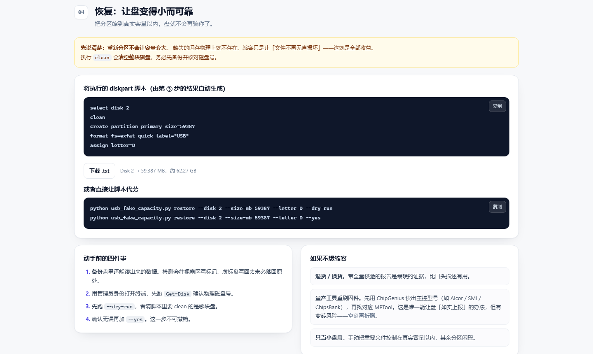
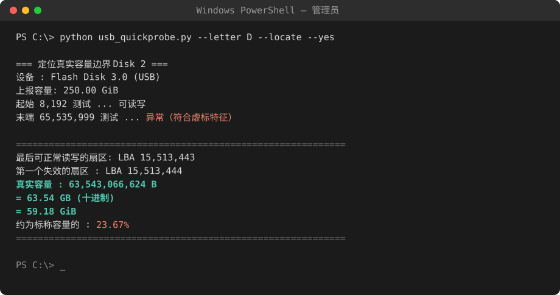

# USB Fake Capacity Checker

**English** | [简体中文](README.zh-CN.md)

Two standalone Windows CLI tools that detect **fake-capacity USB flash drives and SD cards** — the kind that report 2 TB but physically hold 64 GB — and safely restore them to their real, reliable capacity.

No dependencies. No installation. Pure Python standard library.


[](https://usb-health-check.app.workbuddy.host/)

---

## Why

A counterfeit drive's controller lies about its size. Writes beyond the real flash capacity either **wrap around** to the start of the address space or are **silently discarded** — but the OS reports success either way. You find out months later, when the files past a certain point are gone or corrupted.

A real 2 TB USB stick cannot be sold for $10. If your drive reports a suspicious capacity and the vendor name looks like `VendorCo ProductCode`, `Flash Disk`, or `Generic Mass Storage`, test it before you trust it.

| Reported | Actually | Typical symptom |
|---|---|---|
| 2 TB | 32 / 64 / 128 GB | Files beyond the real limit vanish or turn into garbage |
| 250 GB | 64 GB | Filesystem corrupts after ~60 GB written |
| 512 GB | 8 GB | Write speed collapses, then data loss |

---

## Tools at a glance

| Tool | What it does | Time on a "2 TB" drive | Writes |
|---|---|---|---|
| `usb_quickprobe.py` | Samples random sectors, detects address aliasing, binary-searches the exact capacity boundary | **10 s – 3 min** | ~2 MB |
| `usb_fake_capacity.py` | Sequential full-disk write + verify (h2testw-style), then repartition to the real size | 40 – 80 hours | Full capacity |

Use `usb_quickprobe.py` to find out **whether** and **where** the drive lies. Use `usb_fake_capacity.py` only when you need a byte-for-byte proof — its real value is the `restore` subcommand.

### Web version — no install, no terminal

`web/` is a zero-dependency single-page app covering the whole workflow in a browser:
risk triage → command generator → **real-capacity calculator** → restore plan → shareable result card.


Open `web/index.html` directly, or use the hosted version: **<https://usb-health-check.app.workbuddy.host/>**

It cannot read raw sectors — browsers have no such API, and pretending otherwise would be dishonest. So the page does what a page can do well: it parses the JSON reports the CLI produces, runs the same capacity math in your browser (binary-search bounds, Wilson 95% interval for sampling), and emits the exact `diskpart` script and `restore` command for your measured value.

The ④ restore section turns a measurement into something executable:



---

## How it works

### Why naive testing fails

Writing a file and opening it again proves nothing: on a fake drive the write "succeeds" and the read returns cached data. Even a real write-then-read-back passes, because the controller maps logical block `L` to physical block `L mod R` (where `R` is the real capacity) and reads back through the same mapping.

### 1. Sparse alias probe — the fast path

The probe writes a **unique, self-identifying marker** into N randomly chosen 4 KiB sectors spread across the whole claimed address space, then reads them all back:

* **Genuine drive** — every sector returns exactly the marker that was written to it.
* **Fake drive (wrap model)** — a write above `R` lands on a physical block that already belongs to a lower logical sector, so that lower sector now returns *somebody else's* marker. The probe parses the marker header, learns `a ≡ b (mod R)`, and computes `gcd` of the differences to recover `R`.
* **Fake drive (drop model)** — writes above `R` are thrown away, so the sector reads back as zeros or stale data.

514 samples over a 2 TB address space is enough to hit the fake region with near-certainty, and the whole probe costs about **2 MB of writes**.

### 2. Binary-search boundary — the exact number

When the drive is the *drop* model, `write(LBA) → read back → compare` becomes **monotonic**: true below the real capacity, false above it. That turns capacity discovery into ~30 single-sector probes (log₂ of the sector count):

```
lo = 32 MiB (always good)
hi = last sector (always bad)
while hi - lo > 1:
    mid = (lo + hi) // 2
    if write_and_readback_ok(mid): lo = mid
    else:                          hi = mid
real_capacity = hi * 4096
```

Result in seconds, accurate to a single 4 KiB sector. If the drive turns out to be wrap-type instead, the tool detects that and tells you to fall back to the sampling mode.

### 3. Cache bypass is mandatory

This is the part most naive scripts get wrong. On Windows, a read immediately after a write is served from the file cache, so a fake drive looks perfect. Both tools open files/devices with `FILE_FLAG_NO_BUFFERING` and use 4 KiB-aligned buffers, forcing reads from the device itself.

Measured on the same stick: **263 MiB/s cached vs 20 MiB/s direct** — a 13× difference that would have hidden the fraud entirely.

---

## Requirements

* Windows 10 / 11 (uses `diskpart`, `ctypes` Win32 APIs, PowerShell for disk enumeration)
* Python 3.9+ (no third-party packages)
* **Administrator privileges** for raw device access and repartitioning (`usb_quickprobe.py`, `usb_fake_capacity.py restore`)

`usb_fake_capacity.py check` works at file level and does **not** require elevation.

---

## Quick start

```bash
git clone https://github.com/dscdtc/usb-storage-fake-capacity-checker.git
cd usb-storage-fake-capacity-checker
```

```bash
# Read-only: what is this drive, and does the name look suspicious?
python usb_fake_capacity.py identify E

# Fast detection: is it fake, and roughly how big is it really?
python usb_quickprobe.py --letter E --dry-run     # plan only, touches nothing
python usb_quickprobe.py --letter E --yes        # ~2 MB of writes, 10 s – 3 min

# Exact boundary, to the sector
python usb_quickprobe.py --letter E --locate --yes

# Restore the drive to its real capacity (preview first!)
python usb_fake_capacity.py restore --disk 3 --size-mb 59387 --letter E --dry-run
python usb_fake_capacity.py restore --disk 3 --size-mb 59387 --letter E --yes
```

> `usb_quickprobe.py` and `restore` need an **elevated** terminal. Running them without it fails cleanly with a permission error — they never partially write.

---

## Usage

### `usb_quickprobe.py` — fast detection

```
python usb_quickprobe.py --letter E [options]
```

| Option | Default | Description |
|---|---|---|
| `--letter L` | — | Drive letter to probe |
| `--disk N` | — | Physical disk number instead of a letter |
| `--count N` | `512` | Number of sampled sectors |
| `--locate` | off | Binary-search the exact capacity boundary |
| `--backup FILE` | — | Save the probed sectors first, write them back afterwards |
| `--dry-run` | off | Print the plan, write nothing |
| `--seed N` | random | Reproducible sampling |
| `--force` | off | Allow non-USB disks |
| `--yes`, `-y` | off | Skip the confirmation prompt |

Exit codes: `0` no anomaly found · `3` fake detected · `2` refused / permission error.

### `usb_fake_capacity.py` — full verification and repair

```
python usb_fake_capacity.py identify D: E:
python usb_fake_capacity.py check  E [--quick | --max-gb N] [--resume]
python usb_fake_capacity.py restore --disk N --size-mb M --letter L
```

| Subcommand | Purpose |
|---|---|
| `identify` | Read-only: model, bus type, reported/free capacity, risk warnings |
| `check` | Sequential write + verify. `--quick` tests the first 16 GiB, `--max-gb N` caps the test size, `--resume` verifies a previously written run |
| `restore` | Wipes the disk with `diskpart` and creates one partition of the real size |

`check` writes `_wbchk_XXXXX.bin` files, flushes every 128 MiB, and deletes them when done. Progress state is kept in `%TEMP%` so an interrupted run can be resumed.

---

## Case study

A drive sold as **250 GB**, model string `Flash Disk 3.0`, exFAT, empty:



The binary search pinned the boundary to a single 4 KiB sector: **63.54 GB (59.18 GiB)** of real flash — 23.67% of what the controller advertises. Everything written past that point was silently discarded.

A second drive sold as **2 TB** (`VendorCo ProductCode`) failed 501 of 514 samples, with the first dead sector at 68.44 GiB — a 64 GB-class chip.

Neither drive ever needed a full write pass. Total time: under two minutes each.

---

## How this compares

| Tool | Speed | Open source | Windows-native | Finds exact capacity |
|---|---|---|---|---|
| **usb_quickprobe.py** | minutes | ✅ MIT | ✅ | ✅ (binary search) |
| h2testw | hours | ❌ | ✅ | ✅ |
| [f3](https://github.com/AltraMayor/f3) (`f3probe`, `f3fix`) | minutes | ✅ GPLv3 | ❌ needs Linux/WSL | ✅ |
| ValiDrive (GRC) | minutes | ❌ freeware | ✅ | ❌ detection only |
| ChipGenius | seconds | ❌ freeware | ✅ | ❌ reads flash ID, needs interpretation |

If you are on Linux, use `f3probe` — it is the mature, battle-tested reference implementation. This project exists because it gives Windows users the same speed without needing WSL or a Linux live USB.

---

## Safety

Read this before running anything.

* **`usb_quickprobe.py` writes to raw sectors.** It touches `--count` 4 KiB sectors (≈ 2 MB by default) at pseudo-random offsets across the disk. On a drive holding data, that data is at risk. Use `--backup` to save and restore those sectors (best effort — on a fake drive the write-back may not land where it came from). Prefer an empty or reformattable drive.
* **`restore` destroys everything on the disk.** It runs `diskpart` → `clean` → `create partition` → `format`. It refuses non-USB disks, oversized partitions, and FAT32 over 32 GB without `--force`. Always run it with `--dry-run` first and read the printed script.
* **Repartitioning does not create capacity.** The missing flash does not exist. `restore` shrinks the volume to the real size so the drive stops destroying data — that is the entire benefit.
* **The probe temporarily dismounts the volume.** The drive letter disappears from Explorer for a few seconds and comes back when the tool exits. Close anything using the drive first.
* Double-check the **disk number** before running `restore`. `Get-Disk` is your friend. Wiping the wrong disk is unrecoverable.

---

## Limitations

* **Sampling is not proof.** A clean probe result means "no fraud found in 514 samples", not "genuinely 2 TB". Only a full sequential write-and-verify can prove that. `usb_fake_capacity.py check` is there for that.
* **Binary search assumes the drop model.** It verifies this assumption at both ends before searching, and bails out (exit code `3`) if the drive behaves the other way.
* **Wrap-model capacity recovery needs collisions.** If the drive wraps and no two probes collide, the exact `R` cannot be derived; increase `--count`.
* **Windows only.** The raw device path (`\\.\PHYSICALDRIVEn`), `FSCTL_LOCK_VOLUME`, and `diskpart` are Windows-specific. The code is short enough to port — PRs welcome.
* **Not every fake is detectable this way.** Some controllers cache the last-written block or return fabricated data on read. If results look inconsistent, run the full verification.

---

## FAQ

**Can I get my 2 TB back?**
No. The flash memory was never there. You can only make the drive honest about what it is.

**Do I need to reformat after testing?**
Recommended. The probe scatters markers across the disk; the filesystem does not know about them. `restore` reformats anyway.

**Will this brick my drive?**
Probing and repartitioning are standard operations; neither touches firmware. Firmware-level "fixes" (mass-production tools such as AlcorMP, ChipsBank APTool, SMI MPTool) can brick a drive — this project deliberately does not go there.

**The drive is genuine but reports slightly less than advertised.**
Normal. Marketing uses decimal GB (10⁹), Windows shows GiB (2³⁰). A "64 GB" drive shows ~59.6 GiB.

**Can I run this on a real hard drive / SSD?**
Technically yes, with `--force`. Don't. It writes sectors.

---

## Contributing

Issues and pull requests are welcome — especially reports from drives with other fake controllers, and ports to macOS/Linux. When filing a fake-drive report, include the model string, reported capacity, probe JSON, and the exact boundary if you ran `--locate`.

---

## License

[MIT](LICENSE)

This tool is provided for testing and recovering **your own** drives. It writes to disks and can destroy data if pointed at the wrong one. No warranty; verify the target disk number before running `restore`.
